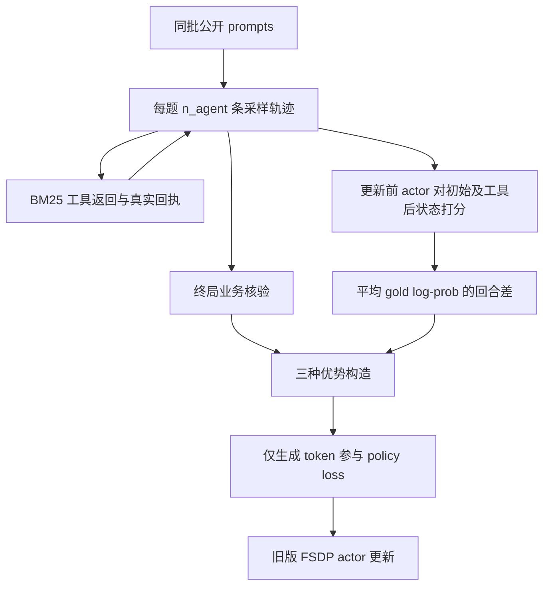

# 按代码理解项目

## 阅读路线

1. `data.py`：规格、报价和政策从冻结事实生成；同家族只属于一个 split。查看一条 `tasks.jsonl` 与其引用的公共文档，理解哪些字段对模型可见。
2. `protocol.py`、`retrieval.py`、`reward.py`：分别对应动作解析、真实检索回执和严格终局核验。先运行 `demo`，再读 `tests/test_environment.py` 的拒绝篡改案例。
3. `evaluate.py`：独立于 RL 的模型→工具→模型循环。`ScriptedProcurementPolicy` 只用于环境检查，`HuggingFacePolicy` 才是实际模型生成。
4. `training/generation.py`、`batching.py`：保留模型生成的原始 token ID；工具 token 的 turn ID 为 -1；活跃批次缩小时补齐 worker 数，然后去掉补齐样本。
5. `training/scoring.py`、`advantages.py`：看 gold 的隔离打分与优势分配，再运行 `tests/test_training_math.py` 和 `test_training_cpu.py`。
6. `training/trainer.py`、`workers.py`：串起 actor/ref 打分、奖励、优势、PPO 更新、验证和保存；真正的 FSDP/vLLM 接口来自固定上游。
7. `launch_train.py`、`preflight.py`、`tracking.py`：了解参数如何落到 Hydra、失败如何记录、正式实验如何保证可追溯。

## 一次训练迭代

GRPO 不调用 gold scorer。IG 两组在同题采样组内，把所有实际交互的 IG 值合并标准化；outcome 单独标准化。默认 gamma=1，每回合的优势是后续 IG 加上终局 outcome。最终回答回合只有 outcome；广播组把首回合累计值复制到所有生成回合，不再做一次 GRPO 归一化。常数组和不足两个值的标准化返回零。

gold scorer 只计算 offer ID token 的平均 log-prob；每个状态追加相同的 `\n<answer>` 前缀。初始状态去重，较长状态分批评分。最终模型答案和最终引用不进入这些状态。私有答案可能出现在评分批次和训练诊断中，但不进入 actor 的真实生成上下文或工具响应。

## 与上游的边界

固定 [Search-R1 bundled veRL] 的 worker/resource pool、DataProto、PPO loss、FSDP/vLLM 切换和模型 checkpoint 接口；项目负责 rollout、数据、verifier、评分、优势及 driver。

项目修复通过适配实现，上游 checkout 保持干净：

- 旧补齐函数在 1 条活跃样本/3 worker 时补齐不足。
- 独立 driver 精确执行配置的训练迭代，验证保留尾批且按题目加权。
- 显式接入训练种子，并替换旧 sharding manager 的固定 rollout RNG 种子。
- actor 子类沿用原 loss，在 optimizer.step 前拒绝非有限梯度，并记录参数变化样本。

`global_steps` 是 rollout/update 迭代数，一次迭代可有多个 PPO mini-batch optimizer step。工具调用产生的 observation 参与后续模型上下文，不能参与策略梯度。

## 已知边界

- 模拟器是有明确候选目录的离线任务；不代表真实采购部署或开放商城泛化。
- IG 是正确答案置信度的代理信号，不等于检索质量本身；重复/无关文档需在真实实验中分析。
- 未实现论文的专用 attention mask 加速、AnySearch 预算课程、共同格式 SFT 或 optimizer/RNG 完整恢复。
- 并列最优由 verifier 的最优集合规则接受，主生成数据保持唯一最优；额外压力测试集需单独冻结并报告。
- CPU fake worker 验证接线、mask、数学和步数，不验证 CUDA kernel、FSDP 通信、vLLM 权重同步或显存。
