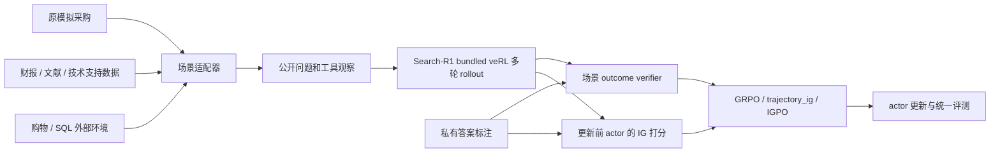

# 开源业务场景选型与接入方案

调研日期：2026-10-03。用户已明确：**允许人工标注和部分合成，只要有真实业务资料作为基础，不是全部自行合成。** 原模拟采购代码、数据和操作说明继续保留。

本文区分上游已提供的能力与本项目拟增加的能力。当前完成的是来源核查、选型和接入设计；**下面这些场景尚未接入本项目的训练入口，也没有下载数据或运行对应模型实验。** 现有 CPU 验收仅覆盖原模拟采购场景。

## 1. 推荐怎么选

结合目前的代码和“Agentic RL / Post-training 求职项目”目标，我建议从下列三条路线选一条做主实验，再考虑跨场景验证。这是工程判断，不是这些数据集的性能排名。

| 优先目标 | 推荐路线 | 适合本项目的理由 | 主要工作 |
|---|---|---|---|
| 保留 Search-R1 检索与 IGPO 研究主线 | **FinQA 起步，DocFinQA 扩展** | 真实财报、专家问题、可验证数值结果；短答案便于定义 IG 打分目标 | 数据导入、表格检索、受限计算器、数值/程序 verifier |
| 尽快展示完整的多步业务 Agent | **WebShop 文本环境** | 已有商品搜索、详情、选规格、购买和终局奖励 | 有状态环境服务、动作协议、会话隔离、多解与 IG 的处理 |
| 中文购物与用户偏好场景 | **ShopSimulator** | 真实淘宝商品资料，已有中文任务与购物环境 | 核验发布资源、冻结环境和奖励；先做普通需求，再扩展模拟用户 |

**我的首选是金融路线。** 当前代码已经围绕“检索后答案置信度如何变化”组织，财报数值问答比较容易延续这个研究问题。FinQA 可先验证导入与奖励，DocFinQA 再提供真正较长的检索空间。它们没有现成的本项目训练适配，需要实现环境封装。

如果你更在意像 ShopSimulator → shopping-grpo-longhorizon 一样，直接在外部业务环境上做后训练，优先 WebShop 或 ShopSimulator。Agent 的多步操作本身更容易展示，但迁移不是简单替换检索语料。

## 2. 候选总览

“现成环境”指上游是否提供可调用的交互状态和反馈；有 QA 数据集并不等于已有 RL 环境。规模来自论文或发布说明，实际实验必须记录下载版本和导入后数量。

| 场景 | 真实基础与任务来源 | 公开规模参考 | 上游形态 | 可做的 Agent 项目 |
|---|---|---|---|---|
| [WebShop](https://github.com/princeton-nlp/WebShop) | 真实商品页面；人工众包购物指令；环境含派生价格/预算 | 约 118 万商品、12,087 条指令 | **交互环境 + 奖励** | 搜索、比较、选规格、完成购物 |
| [ShopSimulator](https://github.com/ShopAgent-Team/ShopSimulator) | 淘宝商品快照；人工购物需求；合成画像与模拟用户 | 论文约 134 万商品、28,147 个任务；不代表已核验本地下载数 | **交互环境 + 奖励** | 中文购物助理、偏好理解、需求澄清 |
| [FinQA](https://github.com/czyssrs/FinQA) | 真实公司财报；金融专家编写问题与推理程序 | 8,281 道题 | QA + 程序评测 | 检索财报、计算指标、回答并给出证据 |
| [DocFinQA](https://huggingface.co/datasets/kensho/DocFinQA) | 原 FinQA 问题与完整 SEC 报告；额外程序标注 | 7,437 道题，801 份报告 | 长文档 QA | 在完整财报中逐步定位信息并计算 |
| [TAT-QA](https://github.com/NExTplusplus/TAT-QA) | 真实财报表格/文本；人工问答 | 16,552 道题、2,757 个表文上下文 | QA + EM/F1 评测 | 财报表文联合检索与分析 |
| [ConvFinQA](https://github.com/czyssrs/ConvFinQA) | 基于 FinQA 的真实财报；把问题拆分/组合成对话 | 3,892 段对话、14,115 个问答回合 | 对话 QA + 程序评测 | 带历史计算结果的财务追问 |
| [BioASQ Task B](https://participants-area.bioasq.org/datasets/) | 生物医学专家问题；真实 PubMed 文献 | Training 14b 下载表列 5,729 题；需注册 | 检索/QA benchmark | 文献搜索、证据核对、回答研究问题 |
| [PubMedQA](https://pubmedqa.github.io/) | 真实论文标题/摘要；包含人工、未标注、人工构造三个子集 | PQA-L：1,000 道专家标注题 | QA + 标签评测 | 小规模医学文献证据判断 |
| [TechQA](https://github.com/IBM/techqa) | **真实技术论坛用户问题**及 IBM 技术文档 | 原论文 600/310/490 题；当前官方提供 train/dev 与约 80 万文档 | 检索/抽取 QA | 企业 IT 技术支持与故障知识检索 |
| [BIRD-SQL](https://bird-bench.github.io/) | 真实数据库内容；人工问题与 SQL | 12,751 对问答/SQL、95 个库、37 个领域 | 数据库 + 执行评测；有外部环境封装 | 查 schema、探索数据、执行和修正 SQL |

## 3. 电商：最接近你举的两个仓库

### 3.1 WebShop：优先考虑的英文购物环境

[WebShop 论文](https://arxiv.org/abs/2207.01206)明确使用真实商品与众包指令。上游提供文本环境，可以通过 `search[...]`、`click[...]` 与网站状态交互；使用文本入口不必额外部署视觉模型。现成封装还包括 [AgentGym 的 agentenv-webshop](https://github.com/WooooDyy/AgentGym/tree/main/agentenv-webshop)。

拟接入关系：

```text
WebShop 商品/任务/状态转移/奖励
                  ↓ 项目环境客户端
[Search-R1 bundled veRL] rollout → GRPO / trajectory_ig / IGPO
```

需要明确的原始数据边界：

- 这是真实资料上的模拟网站，不是真实用户购买日志。
- 应显式选择人工任务模式 `human_goals=True`；上游同时有合成任务分支。[任务源码](https://github.com/princeton-nlp/WebShop/blob/master/web_agent_site/engine/goal.py)
- 即使使用人工指令，上游仍可能追加随机预算；区间价格会采样，缺失价格有默认值。你允许部分合成，因此可以沿用，但要冻结实际商品价格与任务预算，写入 manifest。仅记录种子不足以证明不同进程消费随机数后得到相同任务。[价格源码](https://github.com/princeton-nlp/WebShop/blob/master/web_agent_site/engine/engine.py)
- 原始奖励按属性、规格、价格等匹配，不能替换成“只认某一个商品 ID”，否则任务改变。IG 若只打分一个参考商品，会偏向单一解；需要单独研究目标答案集合或明确标记为参考答案代理。

**工程判断：** 有状态动作比当前纯搜索丰富，演示效果好。要实现每条 rollout 独立会话、reset、超时、终局、可用动作约束和并行隔离。上游依赖包含搜索索引和 Java，应与训练 Python 环境分开安装，通过本地服务连接。小商品子集适合调试，但只有目标商品和规格仍完整可用的任务才有效；筛选规则与数量必须公开。

### 3.2 ShopSimulator：可以满足你补充后的要求

[论文的环境构建章节](https://arxiv.org/html/2601.18225v1)说明商品来自 2025 年 6 月淘宝快照，普通购物需求由人工编写；画像包含 LLM 草稿，用户对话可以由模型模拟。因此它有明确的真实商品基础，同时有合成部分，符合当前筛选标准。

建议从 **single-turn、non-personalized** 设置起步。这里的 single-turn 是一次用户需求，Agent 仍可连续搜索、查看商品和选规格；不要把它理解成 Agent 只能调用一次工具。之后再增加画像或模拟用户，并把用户模拟模型的版本、费用和随机性纳入记录。

你给出的两个仓库确实体现了“环境提供方 → 后训练项目”的分工：

- [ShopSimulator](https://github.com/ShopAgent-Team/ShopSimulator) 提供购物环境、评测入口和用户模拟组件。
- [shopping-grpo-longhorizon](https://github.com/YYHDBL/shopping-grpo-longhorizon) 当前 README 说明其内嵌冻结环境，并自行增加 SFT、GRPO、工具适配和评测。其训练基于 **[Modern veRL] `verl==0.8.0`**，AgentLoop 不能直接复制到本项目的旧框架。

**尚待核验：** 本轮未下载数据包核对完整性；检查的 ShopSimulator 根目录未显示明确 LICENSE，不能把公开可见等同于已确认许可。正式纳入 `third_party` 前须核对所选代码和数据版本的授权说明。论文规模、官方发布包、二次开发仓库内嵌的数据也不能混为同一版本。

## 4. 金融：最适合延续当前算法主线

### 4.1 FinQA → DocFinQA

[FinQA](https://arxiv.org/abs/2109.00122)提供真实财报上的专家问题和可执行推理程序。建议的项目名称是“基于真实财报的检索与数值分析 Agent”，操作链为：

```text
收到原始财务问题 → 搜索报告 → 打开表格/段落 → 计算 → 输出答案和引用
```

上述工具链是**本项目拟实现的封装**，不是 FinQA 已自带的交互 API。第一步可以只接搜索和答案核验，随后增加受限四则运算/百分比计算器；不需要运行任意 Python。

导入时分开处理公开资料和私有标注：

| 字段 | 用途 |
|---|---|
| `qa.question` | 原始用户问题 |
| `pre_text`、`post_text`、`table` | 统一序列化后形成公开检索资料 |
| `qa.exe_ans`、`qa.program`、`qa.gold_inds` | 私有结果评分、程序评测与证据分析 |

FinQA 官方曾修复表格正负样本格式不一致造成的标签泄漏。必须统一转换全部原始文本和表格，不能根据 `gold_inds` 决定公开资料的格式或只索引金标片段。官方公共测试集有答案，`private_test.json` 没有答案，后者不能用于本地计算带金标的训练奖励。[数据格式与修复记录](https://github.com/czyssrs/FinQA)

**为什么还需要 DocFinQA：** FinQA 的部分上下文很短，一次搜索可能足够，不一定适合证明多轮信用分配。[DocFinQA 论文](https://aclanthology.org/2024.acl-short.42/)把 7,437 个原问题扩展到完整财报，平均上下文约 12.3 万词。拟采用分块、检索、按需阅读，让模型看到有限证据；不用把整份报告塞进 3B 模型的上下文。

注意 DocFinQA 的额外 Python 解答包含程序转换/生成过程，真实基础是财报和原问题。FinQA 与 DocFinQA 存在题目继承关系，不能在 FinQA 训练后把同题的 DocFinQA 包装成独立测试。应按原问题 ID 建立映射并去重。[构建方法](https://arxiv.org/html/2401.06915v2)

**奖励设计建议：** 若最终输出程序，复用原程序执行评测；若输出数值，定义并命名本项目的数值准确率，固定百分数、单位和舍入规则，不能称作完整的官方 program accuracy。引用有效率单独记录；需要加入终局奖励时，对三个算法使用完全相同的定义。IG 可对规范化短答案打分，仍须承认同一数值有多种文本表示。

### 4.2 TAT-QA 与 ConvFinQA：扩展方向

- **[TAT-QA](https://github.com/NExTplusplus/TAT-QA)**：适合表格与文本联合推理，答案涵盖数值和文本片段。优先从 `dataset_raw` 导入，派生的 `facts`、`mapping` 等监督字段不进入工具输出。复用其 EM/F1 和单位处理规则；多片段答案会让 IG 的目标规范化更复杂。
- **[ConvFinQA](https://github.com/czyssrs/ConvFinQA)**：提供对话级和回合级数据，是基于财报问题拆分/组合的对话，符合“允许部分构造”的要求。它的用户追问回合与我们研究的工具调用回合是两种概念；固定历史问答后仍要让 Agent 自己决定检索和计算。官方 README 说明 test 未提供参考答案，离线开发应使用有标注的 train/dev 并公开划分。

金融数据可以直接使用原始英文，不必调用模型翻译整套数据。若添加中文翻译，应单独标记为派生版本，保存原题映射，重新检查数字与单位。

## 5. 其他业务领域

### 5.1 医学文献：BioASQ 优先，PubMedQA 适合小规模验证

**BioASQ Task B** 有专家编写的问题，以及文献、片段、答案标注。适合做“医学文献检索与证据核对 Agent”。先选 yes/no、factoid、list 等能较明确评分的题型；摘要式 ideal answer 的主观评分可后续再做。[官方任务说明](https://participants-area.bioasq.org/general_information/Task14b/)

官方训练集下载需注册；14b 下载表目前列 5,729 题，而任务说明页仍有 5,389 的口径，实验以具体下载文件、版本及哈希为准。Phase B 提供的金标片段不能直接当作 Agent 自己检索所得。应建立冻结的文献语料并保存真实检索回执；仅有标注的正确片段不足以构成开放检索任务。[下载入口](https://participants-area.bioasq.org/datasets/)

**PubMedQA** 的 PQA-L 有 1,000 道专家标注题，PQA-U 是未标注集，PQA-A 是约 21.13 万道人工构造题。你允许部分合成，但仍应分别记录子集来源；初版用 PQA-L 即可。答案是 yes/no/maybe，奖励容易实现，不过数据较少、答案空间很小，不一定能产生有意义的多轮 IG 差异。[官方项目页](https://pubmedqa.github.io/)

这两条路线属于文献研究任务。构建 PubMedQA 检索库时只使用任务允许的正文上下文，保留结论/`LONG_ANSWER` 等答案字段在私有侧，避免把答案章节混进公开工具结果。[数据仓库](https://github.com/pubmedqa/pubmedqa)

### 5.2 企业技术客服：TechQA

如果希望连问题也来自真实用户，**TechQA 很有价值**。问题来自 IBM 技术论坛，参考答案对应技术支持文档。原论文给出 600/310/490 的 train/dev/eval 数量；当前仓库说明公开入口提供 train/dev 和约 80 万 TechNotes，排行榜已停止维护。[论文](https://arxiv.org/abs/1911.02984)、[发布说明](https://github.com/IBM/techqa)

拟做“搜索知识库 → 核对产品/版本/错误描述 → 回答并引用”的 IT 支持 Agent。其数据提供的是知识问答，不包含真正执行修复命令的业务系统。沿用官方抽取答案与无答案处理，小数据下增加检索基线和未训练模型基线。额外合成训练题可以另建分支，原始真实问题留作可追溯评测。

### 5.3 企业 BI / 数据库查询：BIRD

**BIRD-SQL** 包含真实数据库内容和人工问题/SQL；可以设计“查看 schema → 查询样例值 → 生成 SQL → 执行 → 根据错误修正”的 Agent。用执行结果评测，允许不同 SQL 得到正确结果，不以 SQL 字符串完全一致判对。[官方数据说明](https://github.com/AlibabaResearch/DAMO-ConvAI/tree/main/bird)

它也有与你举例相似的现成封装关系：**BIRD → [AgentGym SQLGym](https://github.com/WooooDyy/AgentGym/tree/main/agentenv-sqlgym)**。可参考服务协议，再接本项目训练器。原始 BIRD 本身是 Text-to-SQL benchmark；不能把后来的其他 BIRD 变体都当成同一个版本。

**工程判断：** 对 GRPO 很合适，对当前短 gold 答案形式的 IGPO 较复杂。若改为给 gold SQL 打分，会偏向某一种等价写法；若改为结果集打分，需要处理排序、重复行与大结果集。数据库应为冻结的只读副本，执行有时间和输出上限。官方 `evidence` 属于题目可选知识提示，应按有/无提示设置统一提供，私有 gold SQL 不提供给 actor。

## 6. 获取入口与许可核查

下面是供用户准备数据的官方入口，本轮没有执行下载。网页许可标签属于已核验的发布声明；引用的原始商品页面、财报、论文内容仍需保留各自来源。代码许可不能自动代替数据许可。

| 数据/环境 | 获取入口 | 已核验的声明或待确认项 |
|---|---|---|
| WebShop | [仓库安装和数据说明](https://github.com/princeton-nlp/WebShop)；包含小商品子集选项 | [代码 MIT](https://github.com/princeton-nlp/WebShop/blob/master/LICENSE.md)；记录商品数据来源 |
| ShopSimulator | [官方环境目录](https://github.com/ShopAgent-Team/ShopSimulator/tree/main/shop_env) | 根目录未见明确 LICENSE；下载内容与使用条款待进一步核验 |
| FinQA | [dataset 原始 JSON](https://github.com/czyssrs/FinQA/tree/main/dataset) | [仓库 MIT](https://github.com/czyssrs/FinQA/blob/main/LICENSE) |
| DocFinQA | [Kensho 官方数据文件](https://huggingface.co/datasets/kensho/DocFinQA/tree/main) | 数据卡标 MIT；文件页约 4.7 GB，属于存储体积参考 |
| TAT-QA | [原始数据](https://github.com/NExTplusplus/TAT-QA/tree/master/dataset_raw) | README 明确数据 CC BY 4.0；代码有单独 LICENSE |
| ConvFinQA | [官方仓库 data.zip](https://github.com/czyssrs/ConvFinQA) | 仓库 MIT；test 标签访问方式见官方说明 |
| BioASQ | [官方参与者下载页](https://participants-area.bioasq.org/datasets/) | 需注册；本轮未确认具体数据包许可，不标作无条件开放下载 |
| PubMedQA | [官方仓库](https://github.com/pubmedqa/pubmedqa) | 仓库 MIT；保留文献来源及子集标记 |
| TechQA | [官方仓库指向的 PrimeQA 数据页](https://huggingface.co/datasets/PrimeQA/TechQA) | 数据卡 Apache-2.0；tar 包约 2.96 GB；当前页无详细数据卡正文 |
| BIRD | [官方页面下载链接](https://bird-bench.github.io/) | 数据 CC BY-SA 4.0；原始总量约 33.4 GB，不等于需要一次下载所有部分 |

获取后先保存原包；记录 URL、不可变 revision/commit（有则记录）、获取时间、SHA256、实际条数和许可文件。网页当前 `main` 链接用于找到资源，不能作为最终实验版本号。上游示例使用的老训练依赖无需整体安装到本项目训练环境。

补充候选 **[FinanceBench](https://github.com/patronus-ai/financebench)**：真实公司文档上有专业问答，但公开仓库释放的是 150 道题，不能把论文总规模 10,231 当作可下载训练集。更适合补充评测；问题类型包含构造部分，使用时记录类型。它不是本项目第一套 RL 训练数据的优先选择。

## 7. 接入当前 repo 的具体改动

本节依据本地代码核对，以下工作**尚未实现**。保留 `synthetic` 作为原有场景；新场景采用独立目录、manifest 和配置，逐步提取共用训练逻辑。

| 现有位置 | 当前约束 | 新场景需要补的能力 |
|---|---|---|
| `src/procurement_rl/data.py`、`cli.py` | 生成采购事实与任务，导出采购 parquet | 官方原始数据 importer；保留原题 ID、split、来源与私有标注 |
| `src/procurement_rl/protocol.py` | `<answer>` 验证报价 ID | 数值/文本/SQL/购物动作的场景协议 |
| `src/procurement_rl/retrieval.py` | 小规模公共文档 BM25 服务 | 财报分块和表格表示；或对接外部有状态环境；大语料索引需另测 |
| `src/procurement_rl/reward.py`、`training/reward_manager.py` | 可行报价、最优价与引用验证 | 每个场景自己的 outcome verifier；原始 benchmark 指标与新增证据指标分开记录 |
| `training/generation.py`、`evaluate.py` | search / evidence / answer 回路 | 新动作执行、会话隔离、状态回执；训练和评测共享相同协议 |
| `training/scoring.py` | 直接读取 `gold_offer_id` | 场景提供私有规范化目标；多解、单位、截断与答案长度检查 |
| `scripts/preflight.py`、配置和 tracking | 采购数据预检与哈希 | 场景 schema、外部服务版本/语料核验、数据来源和转换记录 |
| `metrics.py` | 以商品 family 聚类做配对统计 | 按报告/数据库/原始问题组定义统计单位，并记录在结果中 |

拟采用的模块边界如下。这是设计示意，图中的新增适配器还不存在：



### 数据与实验约定

1. **真实来源可追溯。** 记录原始文档 ID、商品 ID 或数据库版本；部分合成的预算、画像、题目与教师轨迹分别标记。原始事实缺失时报告或剔除，不悄悄补造。
2. **区分公开事实与私有标签。** 文档中出现答案所需数字是正常证据；`gold_answer`、gold SQL、正确商品标签、gold snippet 标记不能由工具暴露。工具端不加载任务答案文件。
3. **检索与引用可回放。** 引用指向该轨迹真实看到的内容。财报行列、文献片段、商品页面分别使用稳定 ID 和内容哈希，避免只校验某个文档存在。
4. **保留原 split。** 先按官方划分报告结果，再审计来源文档重叠；严格按报告或商品组留出的自定义划分另行命名。共享公开语料不等于共享测试答案。不能把原有 family-disjoint 声明套到外部数据上。
5. **三算法对照一致。** 同初始化、题目、工具、终局奖励、解码与交互预算；IG 只在私有训练打分中使用。多解处理先定义再比较，不为提升 IGPO 分数缩窄正确答案集合。
6. **先看是否真的需要交互。** 比较直接回答、固定一次检索、多轮未训练 Agent 与 RL 后 Agent；不以强制调用次数制造多轮收益。文档过短或三分类答案带来的局限应报告。
7. **证据分阶段记录。** 先 importer/环境 CPU 检查，再 1.5B 学校 smoke，正式结果使用至少 3B。小样本脚本成功、真实模型评测、GPU 更新与完整实验分别记录；显存、费用与提升数字均以实测为准。

## 8. 建议实施顺序

金融路线：导入少量用户下载的 FinQA 原始样本 → 验证公开/私有字段和官方评分对齐 → 统一模型评测 → 接通三算法 → 学校 smoke → DocFinQA 长文档版本 → 正式对照。

购物路线：冻结一个上游环境版本及商品子集 → 独立环境服务 → 多会话 CPU 回放 → 未训练模型合法动作率/终局率 → 先 outcome GRPO → 定义并验证多解 IG 目标 → 三算法对照。

本次到达的阶段是**选型和设计完成**。仓库当前可执行命令仍见原 [README](../README.md)、[服务器步骤](server_setup.md) 与 [实验步骤](experiments.md)，它们覆盖原模拟采购场景。新增真实资料场景的下载和运行专用 README 应与实际适配代码一起补齐，避免提供尚不存在的 CLI 参数。
